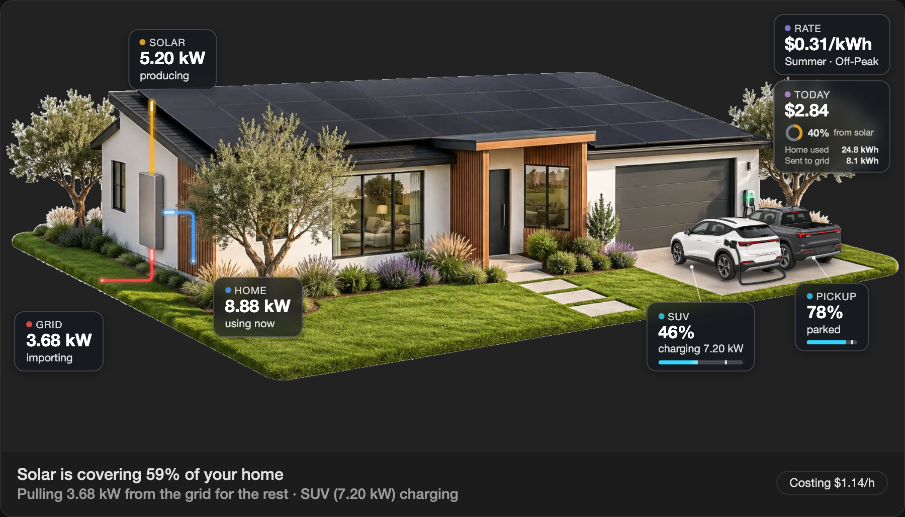
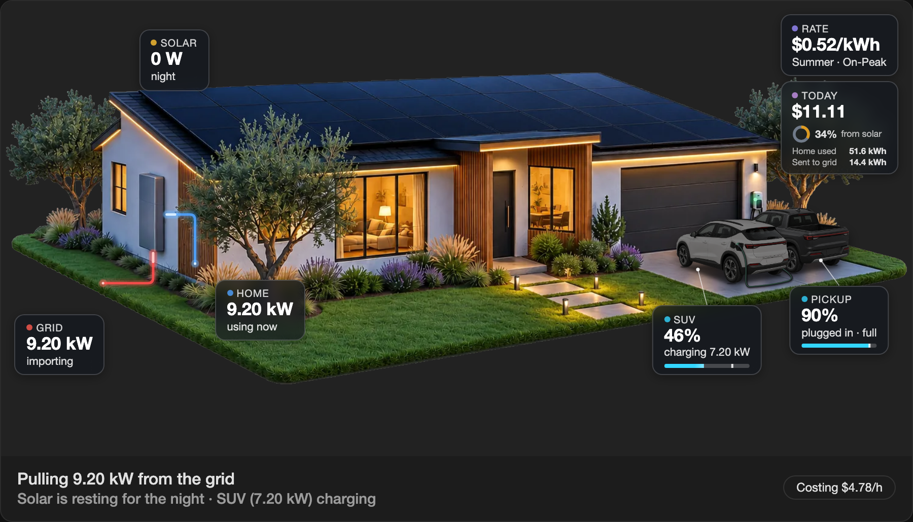
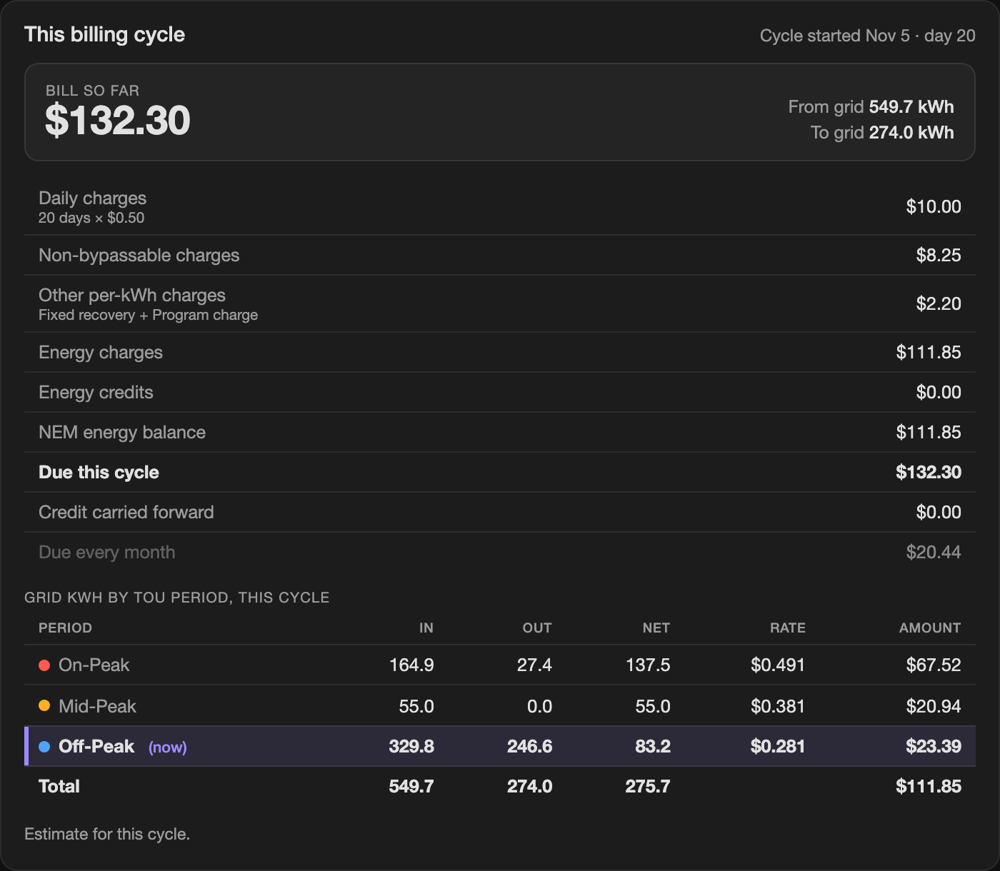
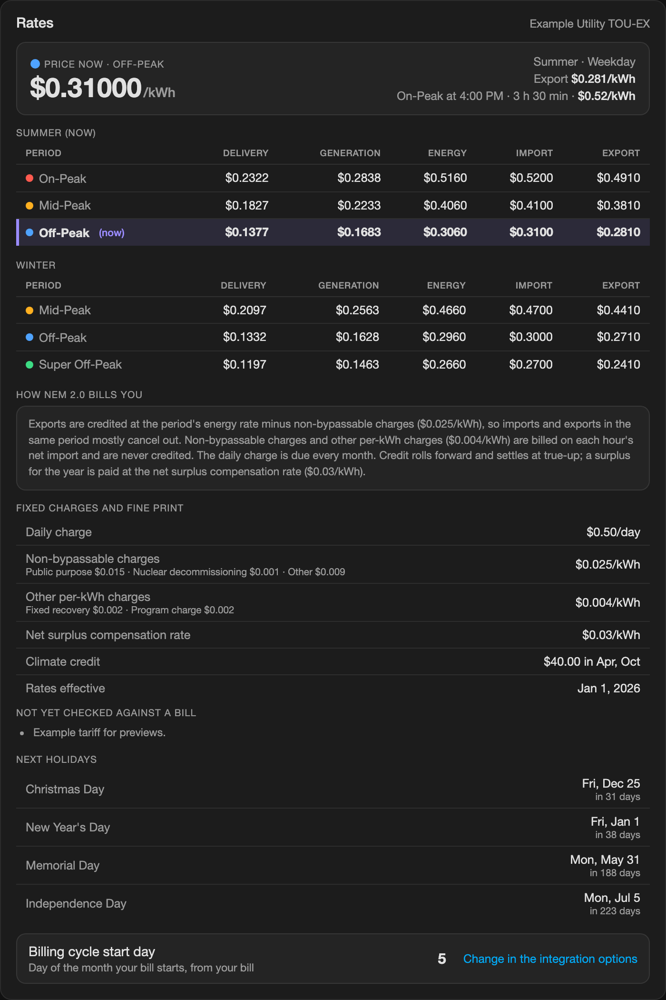
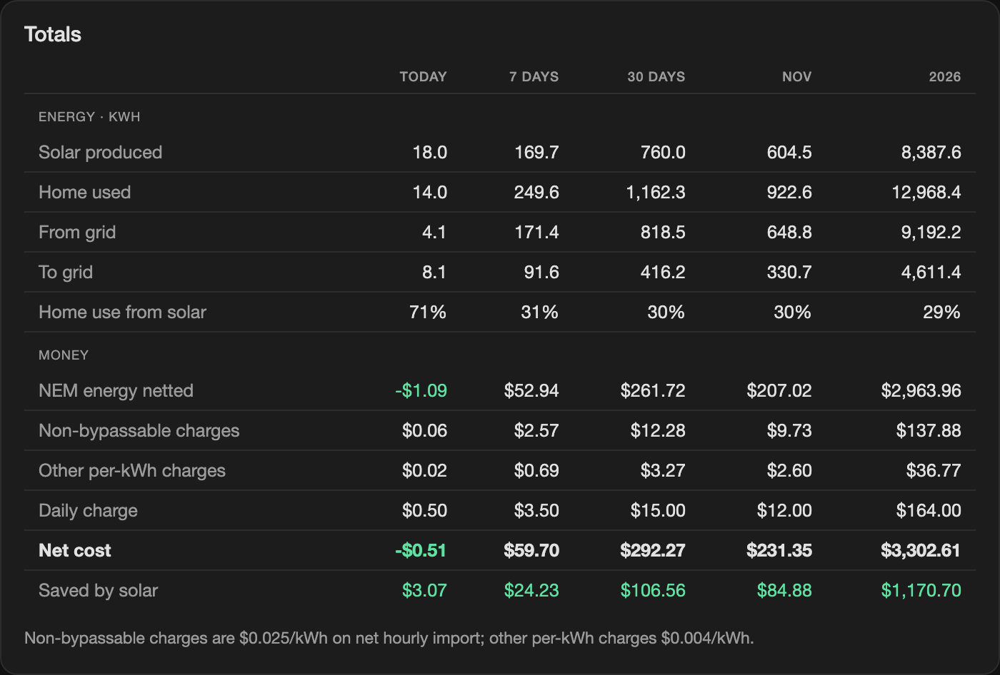
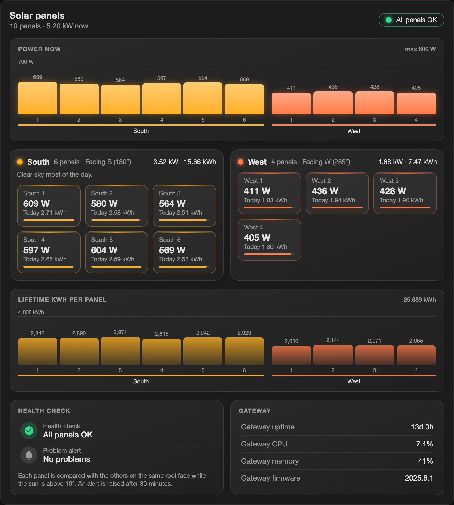
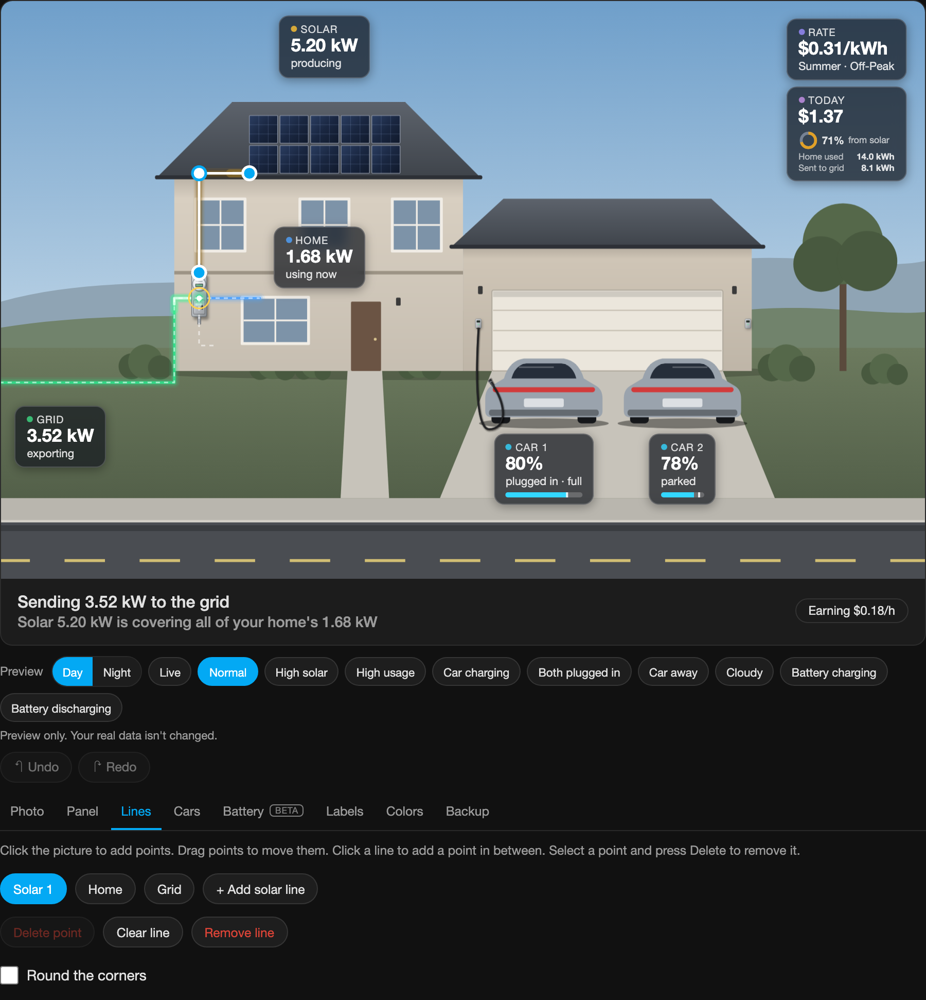

# SunFlow Solar

> **SunFlow is now DayMill.** Same integration, same look, new name. This is
> the last SunFlow release. See
> [Moving from SunFlow](#moving-from-sunflow)
> for the steps.

**Take your power back.**

A free Home Assistant integration that shows what your solar is doing, what
it's saving you, and what your bill is going to be, on a picture of your own
house with the power flowing through it.

## Moving from SunFlow

SunFlow is now DayMill. Same integration, same look, new name. Your setup
keeps working as is. When DayMill 0.2.0 is out:

1. When the DayMill update shows up in HACS, install it and restart Home
   Assistant.
2. Go to Settings > Devices & services. DayMill should show up as
   discovered. If it doesn't, add it yourself. Then pick **Import settings
   from SunFlow**.
3. Open the new DayMill dashboard and check your numbers, house picture
   and cars.
4. Delete the SunFlow integration entry, then delete the
   `custom_components/sunflow_solar` folder and restart.
5. In Settings > Repairs, open **Take over your old SunFlow entity IDs**
   so your automations and Energy dashboard keep working.

The full steps will be on the DayMill page once it's out.

## Why I built this

I have SunPower panels. After SunPower went under, I wanted to see my own data
without depending on anyone's app or subscription. My PVS already has it,
sitting on my own network.

Home Assistant can already read the PVS locally. What it didn't have was a
dashboard that actually tells you something: is the sun covering the house
right now, what's power costing me this hour, how much did solar save me this
month, is a panel acting up, and roughly what's my bill going to be. So I
built that, and then made it work for any solar system, not just mine.

It's free, it runs entirely in your Home Assistant, and nothing is sent
anywhere.

## What you get

- **A house card.** A picture of your house with glowing lines for solar,
  home and grid. The lines speed up with the power. Your cars show up in the
  driveway when they're home, with a cable and a charging glow when they're
  plugged in. Switches to a night picture after sunset.
- **A full dashboard, set up for you.** Home, Totals, Rates, Panels and
  History views. No other custom cards needed.
- **Right now.** Current price and rate period, when it changes next, % of the
  house running on solar, and any problems.
- **Money.** Cost today, what solar saved you, export credits, and a running
  bill estimate for the current billing cycle.
- **Totals.** Produced, used, imported, exported and cost for today, 7 days,
  30 days, this month and this year.
- **Rates.** Time-of-use periods, holidays, and a plain explanation of how net
  metering bills you.
- **Panel health.** Per-panel power and lifetime energy, grouped by roof, with
  a heads-up when one panel falls behind the others on the same roof.
- **Energy dashboard ready.** Sensors you can drop straight into Home
  Assistant's own Energy dashboard, including cost.
- **Cars.** Any number of EVs, with a "charging at home" sensor for each.
- **Battery** (beta).
- **Visual editor.** Upload your house picture and drag the lines, panel,
  cars and labels into place. No YAML needed.

### Screenshots

| | |
|---|---|
|  |  |
|  |  |
|  |  |

The house in the screenshots is a made-up demo house, not mine. You can play
with a live demo at **[sunflow.keocodes.com](https://sunflow.keocodes.com)**.

## Before you install

SunFlow doesn't talk to your solar directly. It reads what your solar
integration already puts in Home Assistant, so get that working first.

- **SunPower PVS5 / PVS6:** install
  [pvs-hass](https://github.com/SunStrong-Management/pvs-hass). The password
  is the last 5 characters of your PVS serial number. Turn on "live data" in
  its options for second-by-second updates.
- **Everything else:** set up your solar's integration (Enphase, Powerwall,
  SolarEdge, Fronius, etc.) and make sure you can see solar power and grid
  power in Home Assistant.
- **Cars (optional):** set up your car's integration too. See [Cars](#cars).

Needs Home Assistant 2026.8 or newer.

## Install

### Option 1: HACS / Marketplace (recommended, gets updates)

1. Click the button above. On Home Assistant 2026.11 or newer it opens the
   Marketplace. On older versions, use
   [this link](https://my.home-assistant.io/redirect/hacs_repository/?owner=Derkaramma&repository=sunflow-solar&category=integration)
   instead, or add `https://github.com/Derkaramma/sunflow-solar` as a custom
   repository (type: Integration) in HACS by hand.
2. Press **Install** on **SunFlow Solar** (in HACS it's called **Download**). Restart if it asks.
3. Start the setup:
   

### Option 2: Manual

1. Download the latest zip from
   [Releases](https://github.com/Derkaramma/sunflow-solar/releases).
2. Copy the `custom_components/sunflow_solar` folder into your
   `/config/custom_components/` folder.
3. Restart Home Assistant.
4. Go to **Settings > Devices & services > Add integration** and pick
   **SunFlow Solar** (or use the setup button above).

To update, do the same thing with the new zip.

### Cards

The cards load on their own. If your dashboard resources are managed in YAML,
Home Assistant shows a repair with the one line to add.

## Setup

The setup walks you through it one step at a time:

1. **Your solar.** It looks for a supported system and fills things in. If it
   can't, you pick the sensors yourself.
2. **Power and energy.** Solar, grid (and which direction is "importing"),
   and home use if you have it. If you don't, SunFlow works it out.
3. **Panels** (optional). Group your panels by roof so the health check
   compares panels that get the same sun.
4. **Battery** (beta, optional).
5. **Cars** (optional). Add as many as you have.
6. **Rates.** Pick your utility plan and net metering version, your billing
   day, and any fixed daily charge. Or turn cost tracking off.
7. **Done.** It creates the sensors, can build the SunFlow dashboard for you,
   and tells you exactly what to pick in the Energy dashboard.

You can change any of it later under **Configure**.

Then open the house card editor and add your own picture. The
[prompts](prompts/README.md) folder has the exact steps I used to turn photos
of my house into the render, with blanks for yours.

## Supported systems

| System | Integration |
|---|---|
| SunPower PVS5 / PVS6 | [pvs-hass](https://github.com/SunStrong-Management/pvs-hass) (recommended), [hass-sunpower](https://github.com/krbaker/hass-sunpower), [ha-esunpower](https://github.com/smcneece/ha-esunpower) |
| Enphase | Enphase Envoy (built in) |
| Tesla Powerwall | Powerwall (built in) |
| SolarEdge | SolarEdge (built in) |
| Fronius | Fronius (built in) |
| Anything else | Pick your sensors by hand. If it has solar power and grid power, it works. |

My own system is a SunPower PVS6 without a battery, so that's what's tested
the most. If something's off with your setup, open an issue and I'll look.

## Cars

SunFlow reads your car from its own integration. Some that work:

- **Tesla:** Tesla Fleet, Teslemetry or Tessie (all built in)
- **Rivian:** [home-assistant-rivian](https://github.com/bretterer/home-assistant-rivian)
- **Kia / Hyundai:** [kia_uvo](https://github.com/Hyundai-Kia-Connect/kia_uvo)
- **Ford / Lincoln:** [ha-fordpass](https://github.com/marq24/ha-fordpass)
- **Polestar:** [polestar_api](https://github.com/pypolestar/polestar_api)
- **Lucid:** [ha-lucidmotors](https://github.com/borski/ha-lucidmotors)
- **BMW / MINI:** [BavarianData](https://github.com/JustChr/BavarianData)
- **Anything else:** A Better Routeplanner (built in) for battery level, or
  your charger's integration (Tesla Wall Connector, Wallbox, Emporia,
  ChargePoint, OCPP)

For each car you pick whether it's charging. If you have them, you can also
pick where it is, charging power, battery level, whether it's plugged in, and
the charge limit.

**Tip:** SunFlow only needs to read from your car. Most car integrations also
add buttons to unlock doors, open the trunk and so on. If you don't use those,
disable them in the car's integration so nothing can poke your car by
accident.

## Rates and net metering

Pick your plan and SunFlow prices every kWh by time of use, adds the fixed
charges, and keeps a running bill estimate.

- **Included:** SCE TOU-D-PRIME and TOU-D-4-9PM, PG&E E-TOU-C, SDG&E
  TOU-DR1, and a simple flat rate. I'm on TOU-D-PRIME, so that one's the most
  checked.
- **Net metering:** NEM 1.0, NEM 2.0 and NEM 3.0 (beta). NEM 3.0 only works
  with the SCE plans for now. It uses SCE's published hourly export prices for
  the year your system was turned on (2023 through 2027).
- Each plan shows the date its rates are from. If it gets more than a year
  old, Home Assistant reminds you to check for updates.

**These are estimates.** The rate tables aren't official, utilities change
prices, and your real bill has stuff SunFlow can't see. It should land close,
but trust your bill over the dashboard.

Not on your plan? Open an issue with a link to your utility's rate sheet.

## Privacy

- Everything runs inside your Home Assistant. SunFlow doesn't call out to any
  server, and there's no account.
- Your house picture is uploaded to your own Home Assistant and stays there.
  Anyone with the picture's link can open it, so don't post that link.
- Diagnostics downloads hide your entity names, serial numbers and picture
  links.
- The website demo runs in your browser on fake data and stores nothing.

If you make a house render with an image tool, crop out your house number,
street signs and license plates first. See [prompts/privacy.md](prompts/privacy.md).

## FAQ

**Do I need a SunPower system?**
No. Any solar in Home Assistant works. SunPower is just why I started.

**Do I need a picture of my house?**
No. Without one, the card draws a simple built-in house.

**Does it control anything?**
No. It only reads sensors. It never touches your inverter, battery or car.

**My numbers don't match my bill.**
They won't match to the penny. If they're way off, double-check your rate
plan, billing day and daily charge under Configure, then open an issue.

**Can I use my own cards instead of the dashboard?**
Yes. Every card works on its own, and you can take control of the SunFlow
dashboard and change whatever you want.

**Is this from SunPower or SunStrong?**
No. It's my side project. Not affiliated with SunPower, SunStrong, or any
utility or car company.

## Support

Bugs and ideas: [GitHub issues](https://github.com/Derkaramma/sunflow-solar/issues).

SunFlow is free and will stay free. If it saved you a subscription and you
want to say thanks, you can
[buy me a coffee](https://buymeacoffee.com/keocodes).

## License

[MIT](LICENSE). Use it, change it, share it.
